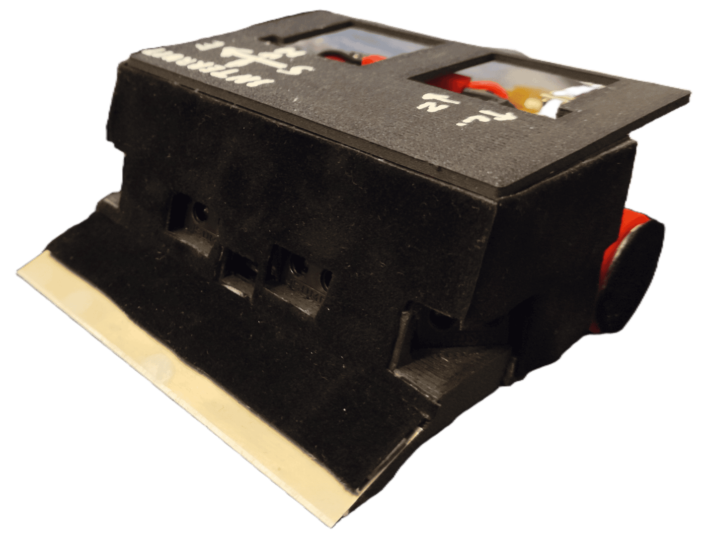

# INTERRUPT

INTERRUPT is Arduino/C++ firmware for a mini sumo combat robot. It implements
sensor-driven opponent detection, edge avoidance, and multiple programmable
opener/attack/retreat strategies for mini sumo competition.

## ⚠️ Not production-ready

This code is written for **my specific mini sumo robot** and is tailored to my
hardware (pin mappings, sensor types, motor drivers, timing constants). It is
**not** a general-purpose or production-ready project. Adapt it to your own
hardware at your own risk.

## No warranty

This program comes with ABSOLUTELY NO WARRANTY. It is provided "as is" without
warranty of any kind, either expressed or implied, including but not limited to
the implied warranties of merchantability and fitness for a particular purpose.
See the LICENSE file (GNU GPL v3) for details.

## AI disclosure

Portions of this project were drafted with the assistance of AI tooling. All
code has been reviewed, adapted, and tested by the author, but AI-generated
content may be present. Use at your own risk.

## License

This project is licensed under the GNU General Public License v3.0. See
[LICENSE](LICENSE) for the full text.
